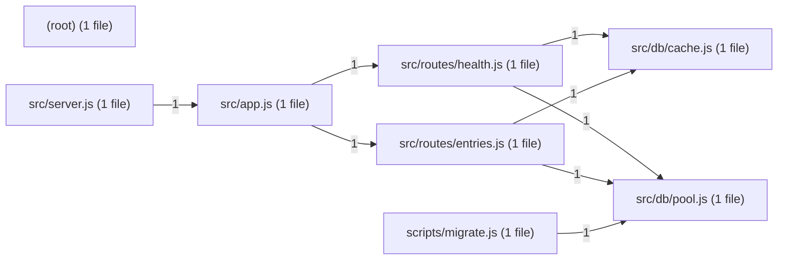

# Architecture

Ledgerly is a small ESM Node.js ledger REST API built on Express, with PostgreSQL (`pg`) as the store and Redis (`ioredis`) as a read cache. It exposes `/entries` (list, create, by-account, balance) and `/health`. There is no build step, no TypeScript and no bundler: the files under `src/` run as they are.

## Modules

| Module | Responsibility |
| --- | --- |
| `src/server.js` | Process entry point; listens on `PORT` (default `3000`). |
| `src/app.js` | `createApp(options)` builds the Express app: helmet security headers, `express.json()` body parsing, a per-IP rate limiter on `/entries` (default 100 requests per 15 minutes, overridable with `rateLimitWindowMs` / `rateLimitMax`), the `/entries` and `/health` routers, and an error handler that logs the error and answers 4xx with a generic message or 500 with `{ error: 'internal error' }` (no stack trace). |
| `src/routes/entries.js` | Ledger entry endpoints: list (Redis-cached), create, by-account and balance. Maps rows to responses through a single `toEntryDto` mapper. |
| `src/routes/health.js` | Health check that pings Postgres and Redis and returns 200 or 503. |
| `src/db/pool.js` | Lazy `pg` Pool singleton (`getPool`) and one promise-based `query(text, params)` helper. |
| `src/db/cache.js` | Lazy `ioredis` client (`getCache`) and a `cached(key, ttlSeconds, compute)` read-through helper. |
| `scripts/migrate.js` | Creates the `entries` table and the index on `entries(account)`. |
| `(root)` | `eslint.config.js`, the ESLint flat config used by `npm run lint` (1 file, 22 lines). |
| `shared` | Git submodule (`hpogorelic/ledgerly-shared`, pinned at `d8a31cb`) providing the validation and money helpers `validateEntry`, `toCents`, `fromCents`, `formatMoney`. Treated as a dependency, not as project code. |
| `test/` | `node:test` tests (`app.test.js`, `entries.test.js`, `routes.unit.test.js`); the integration tests need live Postgres and Redis. |
| `docker-compose.yml`, `Dockerfile` | Local stack (db, cache, app) and the app image. |

Gone after this run:

- `src/legacy-sync.js`: unused push of entries to the old accounting system; deleted together with the deprecated `request` package (7143bde).
- `vendor/reports`: a submodule declared in `.gitmodules` but never checked out; its entry was removed (1fa4010).

## Entry points

- `src/server.js`: the HTTP server (`npm start`, `npm run dev`).
- `scripts/migrate.js`: the schema migration (`npm run migrate`).
- `test/app.test.js`, `test/entries.test.js`, `test/routes.unit.test.js`: the tests (`npm test`, `npm run test:env`).
- `eslint.config.js`: the lint configuration (`npm run lint`).

## Data flow

An HTTP request reaches the Express app built in `src/app.js`. helmet adds the security headers, `express.json()` parses the body, and requests to `/entries` pass the rate limiter (over the limit: 429 `{ error: 'too many requests' }`) before the entries router; `/health` goes to the health router.

- `POST /entries` validates the body with the shared `validateEntry`, converts the amount to cents with `toCents`, inserts the row into Postgres through `query`, awaits the deletion of the Redis key `entries:all`, then answers 201.
- `GET /entries` reads through the Redis cache (`cached('entries:all', 30, …)`, a 30-second TTL) and falls back to Postgres on a miss.
- `GET /entries/by-account/:account` runs a parameterised query on `account`.
- `GET /entries/balance/:account` computes the total in SQL with `SUM(amount_cents)`.
- Rows are mapped back to decimal amounts with `fromCents` in `toEntryDto`.
- `GET /health` runs `SELECT 1` on Postgres and `PING` on Redis.

Route errors are logged with `console.error` and answered with 500 `{ error: 'internal error' }`.

## Diagram

The diagram shows the import graph of the project's own source; each arrow is one import. `src/server.js` imports only `src/app.js`, which wires the two routers, `src/routes/entries.js` and `src/routes/health.js`. Both routers depend on the two store modules, `src/db/pool.js` for Postgres and `src/db/cache.js` for Redis, so every database and cache access goes through those two lazy singletons. `scripts/migrate.js` reuses the same pool helper outside the HTTP server. The root-level file (`eslint.config.js`) has no edges to the application modules. The `shared` submodule is not drawn because it is a dependency, not project code.
